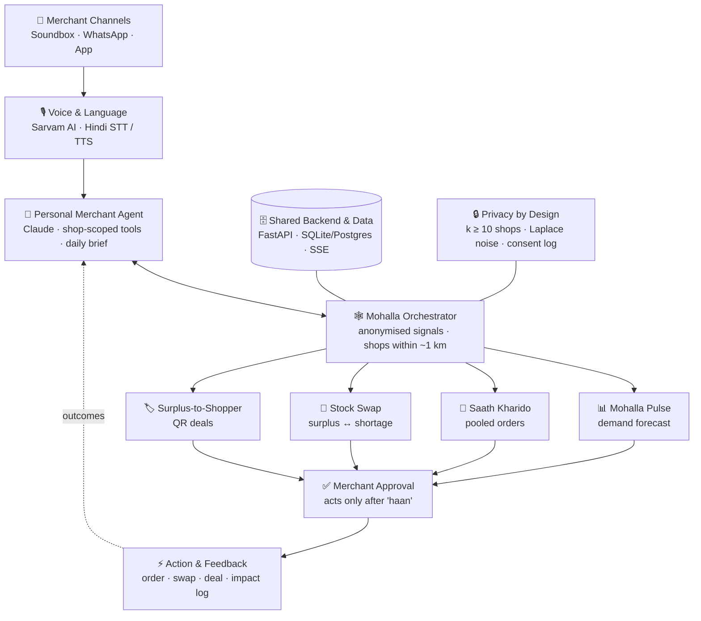

<div align="center">

# 🏪 Mohalla Mind

### AI Agents That Turn a Mohalla Into a Team

**An AI Business Partner for Every Paytm Merchant**

*Paytm Build for India AI Hackathon · Track 1: Merchant Growth AI*

**Team Delhi Debuggers** — Sumit Kumar · Harsh Jamhauria · Mahak Bhadauria

     

</div>

---

## 📖 Table of Contents

1. [The Problem](#-the-problem)
2. [Our Solution](#-our-solution)
3. [How It Works](#-how-it-works)
4. [The Four AI Engines](#-the-four-ai-engines)
5. [What Makes Us Different](#-what-makes-us-different)
6. [System Architecture](#-system-architecture)
7. [Tech Stack](#-tech-stack)
8. [Project Structure](#-project-structure)
9. [Getting Started](#-getting-started)
10. [Running the Demo](#-running-the-demo)
11. [API Reference](#-api-reference)
12. [Privacy & Safety](#-privacy--safety)
13. [Simulated Data](#-simulated-data)
14. [Testing](#-testing)
15. [Business Model](#-business-model)
16. [Pilot KPIs](#-pilot-kpis)
17. [Roadmap](#-roadmap)
18. [Prototype Scope & Limitations](#-prototype-scope--limitations)
19. [Team](#-team)

---

## 🔴 The Problem

**Every small merchant still fights alone.**

Paytm merchants have gone digital on payments, but their business still runs in isolation. Around 2 lakh neighbourhood kirana stores have reportedly shut as shoppers moved to quick commerce. Today's merchant AI answers questions about **one shop**; nothing lets neighbouring shops act **together**.

### A day in Sunita Ji's kirana store

| Time | What goes wrong | Cost to her |
|---|---|---|
| 🌅 **Morning — Overpaid** | Buys 10 bags of atta at small-buyer rates, while the dark store nearby buys in bulk far cheaper | Lower margin, can't compete on price |
| 🌆 **Evening — Stockout** | Runs out of paneer on a festival evening; 3 customers order from a quick-commerce app instead | Lost sales, lost customers |
| 🌙 **Night — Dead stock** | 40 biscuit packs near expiry sit unsold, while 300 shoppers within 1 km would have bought them at a discount | Stock thrown away |

### Why existing tools fall short

| Tool type | Examples | Gap |
|---|---|---|
| Single-shop assistants | Paytm AI Soundbox, BharatPe Agentic AI | Analyse only one merchant's own data |
| Enterprise intelligence | PhonePe PulsePro | Sold to brands, not to the shopkeeper |
| Central aggregators | KiranaPro, 1K Kirana | Shop becomes dependent on one company |
| — | — | **No coordination:** ten shops on one street compete blindly instead of buying and selling together |

> **In one line:** Small shopkeepers lose money because they **buy alone, guess alone and waste alone**, while big players use scale and data to beat them.

---

## 🟢 Our Solution

**Mohalla Mind** gives every Paytm merchant a **personal AI agent** that knows only their own shop. A **Mohalla Orchestrator** connects the agents of all shops within about **1 km**, so they can **forecast demand, buy together, swap stock and sell surplus** as a team.

- 🗣️ **Voice-first:** merchants talk to it in Hindi and other Indian languages via Paytm Soundbox, WhatsApp or the app
- ⏱️ **20-second daily brief:** tomorrow's top 3 actions, spoken aloud
- ✅ **Nothing happens without the merchant's "haan"**
- 🔒 **Privacy-safe:** only anonymised neighbourhood signals are shared, never individual shop sales

> **One AI per shop + one AI per mohalla = 10 small shops behave like one big chain, while each stays independent.**

---

## ⚙️ How It Works

```
 01 Merchant Input   →  02 AI Analysis      →  03 Merchant Approval  →  04 Execution            →  05 Growth
 Speaks in Hindi        Agents analyse          Merchant confirms        System coordinates          Higher sales,
 via Soundbox /         local data and          with a simple            nearby shops, places        fewer stockouts,
 WhatsApp / app         generate top 3          "Haan"                   orders, arranges swaps,     less waste
                        actions                                          activates offers
```

### Example: Sunita Ji's morning brief

> 🔊 *"सुनीता जी, कल ₹8,400 आए। कल दिवाली है, पनीर की माँग 35% बढ़ेगी — 4 किलो ज़्यादा रखिए। आस-पास की 12 दुकानें आटा साथ मँगवा रही हैं, 7% सस्ता — जुड़ें? बिस्कुट के 40 पैकेट पर 10% छूट लगा दें?"*
>
> 🗣️ Sunita Ji: *"Haan."*
>
> ✅ She joins the pooled atta order at the distributor's bulk price.

---

## 🧠 The Four AI Engines

| # | Engine | Solves | What it does |
|---|---|---|---|
| 01 | **📊 Mohalla Pulse** | "I don't know what will sell tomorrow" | Predicts each shop's demand using sales history, festivals, weather and anonymised mohalla signals |
| 02 | **🛒 Saath Kharido** | "I pay more for stock" | Combines nearby shops' restocking needs into one bulk order at distributor tier prices |
| 03 | **🔄 Stock Swap** | "I ran out / I have too much" | Matches one shop's surplus with a neighbour's shortage within 1 km, at cost price |
| 04 | **🏷️ Surplus-to-Shopper** | "My stock is expiring" | Turns near-expiry stock into discount deals for shoppers within 1 km, redeemed at the merchant's Paytm QR |

<details>
<summary><b>Engine logic in detail (click to expand)</b></summary>

#### Mohalla Pulse — demand forecasting
- **Baseline:** `0.5 × mean(last 4 same-weekday sales) + 0.5 × mean(last 14 days)`, multiplied by festival and weather uplift learned from history
- **Model:** LightGBM with features for day of week, festival flags, days-to-festival, weather, temperature, lag-1/7/14 sales, rolling means and shop size
- **Evaluation:** WAPE on a 14-day holdout, baseline vs LightGBM

#### Restock calculation
```
target       = forecast(next lead_time + 1 days) + safety_stock
safety_stock = 1.65 × σ(daily sales, 28 days) × √lead_time
reorder_qty  = max(0, target − usable_on_hand)
```

#### Saath Kharido — pooled buying
1. Collect reorder needs from consenting shops
2. Group by product, sum quantities, look up the distributor price tier
3. Create a pool if **≥ 3 shops** join and savings are **≥ 3%** vs the solo price
4. Each shop gets its own proposal showing its own ₹ saving
5. At the deadline, only approved shops are ordered; the price re-tiers if fewer shops join

#### Stock Swap
```
surplus  = usable_on_hand − forecast(until expiry, max 7 days) − safety_stock
shortage = forecast(next day) + safety_stock − on_hand
```
Shortages are matched greedily to the **nearest** surplus shop within **1,000 m**. Transfer happens at cost price, and only when **both** shops say haan. Near-expiry stock tries a swap first, then a deal.

#### Surplus-to-Shopper
Batches expiring within 3 days with excess stock become deals: **10% off at 3 days, 20% at 2 days, 30% at 1 day**. Never below cost except on the last day. Customers redeem at the shop's Paytm QR, so results are measured, not guessed.

</details>

---

## ✨ What Makes Us Different

| Already exists | Mohalla Mind |
|---|---|
| AI helps **one shop** read its own data | Shops' AI agents **cooperate**: pool orders, swap stock, refer customers |
| Neighbourhood intelligence sold **to brands** | Network demand signals flow back **to the shopkeeper** |
| Pooling run by **one central company** | Every shop stays **independent**; the network is just coordination |
| Dashboards in English | **Voice-first** in Hindi; a 20-second brief and a "haan" |
| ROI is estimated | **Closed-loop ROI:** every deal is redeemed at the merchant's Paytm QR |

**Built on Paytm infrastructure:** runs on Soundboxes already on merchant counters, Paytm QR and UPI data. No new hardware.

---

## 🏗️ System Architecture



**Nightly cycle (run by the orchestrator):**

```
Forecast tomorrow → Restock needs → Stock swaps → Pooled orders → Surplus deals → Hindi daily briefs → Live events
```

Agent-to-agent communication is modelled as JSON intents on an in-process message bus (e.g. `{"from": "agent:shop_7", "type": "NEED", "product": "atta_5kg", "qty": 12}`), which maps directly to the A2A protocol in production.

---

## 🛠️ Tech Stack

| Layer | Technology |
|---|---|
| **Backend** | Python 3.11, FastAPI, SQLAlchemy 2.0, Pydantic |
| **Database** | SQLite for the prototype (PostgreSQL + PostGIS in production) |
| **Forecasting** | Rule-based baseline + LightGBM (Prophet optional) |
| **Optimisation** | Greedy matching (OR-Tools for multi-distributor pooling) |
| **AI Agent** | Claude API with tool use, shop-scoped tools, Hindi system prompt |
| **Voice** | Sarvam AI: Saaras v3 (speech-to-text), Bulbul v3 (text-to-speech), `hi-IN`; browser Web Speech API fallback |
| **Frontend** | Next.js (App Router), TypeScript, Tailwind CSS, shadcn/ui |
| **Maps** | react-leaflet + OpenStreetMap |
| **Charts** | Recharts |
| **Realtime** | Server-Sent Events (SSE) |
| **Data generation** | NumPy, pandas, Faker |

---

## 📁 Project Structure

```
mohalla-mind/
├── README.md
├── CLAUDE.md                     # full build guide for Claude in VS Code
├── backend/
│   ├── requirements.txt
│   ├── .env.example
│   ├── app/
│   │   ├── main.py               # FastAPI app, CORS, routers, SSE
│   │   ├── config.py             # settings from environment
│   │   ├── db.py · models.py · schemas.py
│   │   ├── events.py             # event bus → SSE
│   │   ├── geo.py                # haversine distance helpers
│   │   ├── data/                 # catalog + synthetic data generator
│   │   ├── engines/              # pulse, restock, saath_kharido, stock_swap, surplus, privacy
│   │   ├── orchestrator/         # nightly mohalla cycle + execution
│   │   ├── agents/               # Claude tool-use agent, prompts, approval guard
│   │   ├── voice/                # Sarvam STT/TTS with caching + fallback
│   │   ├── sim/                  # simulated clock
│   │   └── routers/              # shops, proposals, mohalla, deals, voice, sim
│   └── tests/
├── frontend/
│   ├── app/
│   │   ├── page.tsx                    # landing
│   │   ├── soundbox/[shopId]/page.tsx  # merchant Soundbox simulator
│   │   ├── mohalla/page.tsx            # live mohalla map
│   │   ├── customer/page.tsx           # customer deals (phone view)
│   │   └── pulse/[shopId]/page.tsx     # forecast vs actual
│   ├── components/
│   └── lib/api.ts
└── docs/
    ├── demo-script.md
    └── architecture.md
```

---

## 🚀 Getting Started

### Prerequisites

| Tool | Version |
|---|---|
| Python | 3.11+ |
| Node.js | 18+ |
| Git | any |
| Claude API key | from the [Claude Console](https://console.anthropic.com) |
| Sarvam AI API key | from [Sarvam AI](https://www.sarvam.ai) *(optional; the browser fallback works without it)* |

### 1. Clone the repository

```bash
git clone https://github.com/<your-username>/mohalla-mind.git
cd mohalla-mind
```

### 2. Backend setup

```bash
cd backend
python -m venv .venv

# macOS / Linux
source .venv/bin/activate
# Windows
.venv\Scripts\activate

pip install -r requirements.txt
cp .env.example .env          # Windows: copy .env.example .env
```

Fill in `backend/.env`:

```env
DATABASE_URL=sqlite:///./mohalla.db
ANTHROPIC_API_KEY=your_claude_key
CLAUDE_MODEL=claude-sonnet-5-5
SARVAM_API_KEY=your_sarvam_key
USE_LLM=true
USE_SARVAM=true
SIM_START_DATE=2026-11-07
MOHALLA_CENTER_LAT=28.5677
MOHALLA_CENTER_LNG=77.2433
K_ANON_MIN=10
DP_EPSILON=1.0
CORS_ORIGINS=http://localhost:3000
```

> 💡 **No API keys?** Set `USE_LLM=false` and `USE_SARVAM=false`. The app falls back to Hindi templates and browser voice, so the full demo still runs.

### 3. Generate the simulated mohalla

```bash
python -m app.data.generate --shops 30 --days 90 --seed 42 --reset
```

This creates 30 shops in Lajpat Nagar, Delhi, with 24 products, 90 days of sales, festivals, weather and the planted demo scenarios.

### 4. Start the backend

```bash
uvicorn app.main:app --reload --port 8000
```

API docs: **http://localhost:8000/docs**

### 5. Frontend setup

```bash
cd ../frontend
npm install
cp .env.local.example .env.local     # contains NEXT_PUBLIC_API_URL=http://localhost:8000
npm run dev
```

App: **http://localhost:3000**

---

## 🎬 Running the Demo

### Screens

| URL | Who it's for | What it shows |
|---|---|---|
| `/` | Everyone | Landing page with 3 tiles |
| `/soundbox/1` | Merchant (Sunita Ji) | Speaker, Hindi daily brief, hold-to-talk mic, proposal cards with **हाँ / नहीं** |
| `/mohalla` | Judges | Live map of 30 shops, pool and swap lines, impact counters, control panel |
| `/customer` | Shoppers | Nearby deals with QR codes and "Pay at QR" |
| `/pulse/1` | Judges | Forecast vs actual chart with the Diwali spike and model accuracy |

### 3-minute demo flow

| Time | Screen | Action | Story |
|---|---|---|---|
| 0:00 | Slide | — | "Sunita Ji buys alone, guesses alone, wastes alone." |
| 0:20 | `/mohalla` | Show the map | "Every Paytm merchant here has their own AI agent." |
| 0:35 | `/mohalla` | **Run Night** | "Tonight the agents forecast Diwali demand and coordinate." |
| 0:50 | `/soundbox/1` | Play the brief | "Next morning, her Soundbox speaks to her in Hindi." |
| 1:10 | `/soundbox/1` | Say **"haan"** to the atta pool | "Nothing happens without her haan." |
| 1:25 | `/mohalla` | **Auto-approve** others | "12 shops just bought like one chain: 7% cheaper." |
| 1:50 | `/soundbox/1` | Approve the paneer swap | "A neighbour had extra paneer. The customer stays in the mohalla." |
| 2:10 | `/customer` | **Pay at QR** on the biscuit deal | "Expiring stock becomes a local deal, proven at her Paytm QR." |
| 2:30 | `/mohalla` | Impact counters + privacy badge | "No shop sees another's sales." |
| 2:45 | Slide | Business model | "Free for merchants. The network pays." |

**Control panel buttons:** `Run Night` · `Auto-approve others` · `Next Day` · `Reset`

> ⚠️ Keep a recorded backup video of the full flow in case of network issues at the venue.

---

## 🔌 API Reference

| Method | Endpoint | Description |
|---|---|---|
| `GET` | `/health` | Health check + current simulated date |
| `GET` | `/shops` | All shops with location and type |
| `GET` | `/shops/{id}/summary` | Today's UPI revenue, transactions, top sellers |
| `GET` | `/shops/{id}/forecast` | Tomorrow's forecast + history |
| `GET` | `/shops/{id}/brief` | Hindi daily brief (Devanagari + Roman) + audio URL |
| `POST` | `/shops/{id}/chat` | Talk to the agent (text or audio) |
| `GET` | `/shops/{id}/proposals` | Pending pools, swaps and deals |
| `POST` | `/proposals/{id}/approve` | Approve (passes through the safety guard) |
| `POST` | `/proposals/{id}/reject` | Reject a proposal |
| `GET` | `/mohalla/map` | Shops, statuses, active pool/swap lines |
| `GET` | `/mohalla/impact` | ₹ saved, stockouts avoided, waste saved, deal revenue |
| `GET` | `/mohalla/signal?category=` | Privacy-safe aggregate (null if fewer than 10 shops) |
| `GET` | `/deals/nearby?lat=&lng=` | Deals within 1 km |
| `POST` | `/deals/{id}/redeem` | Simulated QR payment |
| `POST` | `/sim/run-night` | Run the orchestrator's nightly cycle |
| `POST` | `/sim/next-day` | Advance the simulated date |
| `POST` | `/sim/auto-approve` | Demo helper: other shops respond |
| `POST` | `/sim/reset` | Regenerate data (seed 42) |
| `GET` | `/events` | Server-Sent Events stream for live updates |

**Example: chat with Sunita Ji's agent**

```bash
curl -X POST http://localhost:8000/shops/1/chat \
  -H "Content-Type: application/json" \
  -d '{"text": "aaj kitna bika?"}'
```

---

## 🔒 Privacy & Safety

| Principle | How it's enforced |
|---|---|
| **Each agent sees only its own shop** | `shop_id` is injected by the server, never chosen by the LLM; tools reject cross-shop access |
| **k-anonymity** | Mohalla aggregates are returned only if **≥ 10 shops** contributed |
| **Noise added** | Laplace noise (ε = 1.0) on shared demand signals |
| **No names in signals** | The agent says "12 nearby shops", never which shops or their sales |
| **Consent** | Shops opt in to sharing aggregates and joining pools (`consent_log`) |
| **Human approval** | Actions execute only after a deterministic "haan" check (हाँ, ठीक है, कर दो, ok, yes) **and** an ownership check. "Nahi" or an unclear reply never executes |
| **Audit trail** | Every decision is logged with time and channel (voice or button) |
| **Graceful fallback** | If the LLM or voice API fails, Hindi templates and browser voice take over |

---

## 🗃️ Simulated Data

The prototype runs on **synthetic data** modelled on real kirana patterns, since live Paytm data requires partner access.

| Item | Details |
|---|---|
| Location | One mohalla in Lajpat Nagar, Delhi, all shops within ~900 m of the centre |
| Shops | 30 (22 kirana, 4 dairy, 4 general stores), sizes S/M/L |
| Products | 24 everyday items: atta, rice, dal, oil, ghee, milk, paneer, curd, biscuits, namkeen, sweets, dry fruits and more |
| History | 90 days of daily sales + UPI revenue |
| Seasonality | Diwali, Dussehra, Raksha Bandhan uplifts; rain/heat/cold effects; weekend bump |
| Pricing | 3 distributor price tiers per product |
| Expiry | Batch-level expiry dates per shop |

**Planted demo scenarios:**
- Sunita Ji has **40 biscuit packs expiring in 3 days** → Surplus deal
- Sunita Ji is **short on paneer**; 2 neighbours within 500 m have extra → Stock swap
- **12+ shops** need atta restock → Pooled order at 7% savings

---

## 🧪 Testing

```bash
cd backend
pytest -v
```

| Test file | What it proves |
|---|---|
| `test_engines.py` | Forecast, restock, pool, swap and deal logic on small hand-made datasets |
| `test_privacy.py` | Aggregates from fewer than 10 shops return null; noise is applied |
| `test_agent_safety.py` | "Nahi" never executes; unclear replies never execute; one shop can never approve another's proposal |

**Forecast evaluation:**

```bash
python -m app.engines.pulse --evaluate
```

Prints WAPE for the baseline vs LightGBM on a 14-day holdout.

---

## 💰 Business Model

**Core is free for merchants (bundled with the Soundbox). The network pays.**

| Revenue stream | Who pays | How |
|---|---|---|
| **Pooled order fees** | Distributors & brands | 1–2% facilitation fee on pooled orders |
| **Inventory credit** | Via Paytm's lending partners | Interest on short loans, auto-repaid from UPI settlements |
| **Hyperlocal deals** | FMCG brands | Pay per redemption at the merchant's QR |
| **Mohalla Pro** *(optional)* | Merchants | ₹99–499/month for advanced forecasts and multi-store view |

**Why it scales**
- **Zero hardware cost:** runs on Soundboxes already deployed, updated over the air
- **Network effect:** every new shop makes pooled orders bigger and forecasts sharper for its neighbours
- **Low unit cost:** daily briefs are batch-generated; only live questions use larger models
- **Low credit risk:** Paytm sees daily cash flow, so loan limits and repayment are data-driven

### What Paytm gains
- 📈 **Lending growth:** inventory credit repaid automatically from UPI settlements
- 📢 **Ad revenue:** brand-funded hyperlocal deals with closed-loop attribution
- 🔁 **Stickiness:** higher Soundbox retention and more consumer-app engagement
- 🇮🇳 **For India:** kiranas stay competitive, less food waste, formal credit history for micro shops

---

## 📏 Pilot KPIs

We will measure these in the pilot instead of claiming numbers in advance:

| Area | KPI |
|---|---|
| **Margin** | Gross margin on pooled SKUs vs solo buying, per merchant |
| **Availability** | Stockout rate and swap fulfilment rate per shop |
| **Waste** | Expiry write-offs per shop, tracked weekly |
| **Growth** | Repeat-customer rate, deal redemptions at QR, inventory-credit uptake |

---

## 🗺️ Roadmap

| Phase | Scope | Goal |
|---|---|---|
| **Phase 0: Prototype** ✅ | 30 simulated merchants, all 4 engines, Hindi voice | Prove the concept |
| **Phase 1: Pilot** | 50 real merchants in one Delhi mohalla | Measure margin, stockouts, waste and credit uptake |
| **Phase 2: Scale** | ~1,000 mohallas across 10 cities with distributor and brand partners | Prove the network effect |
| **Phase 3: Roll-out** | Over-the-air to the AI Soundbox base; Mohalla Pro and brand deals switched on | Mass adoption |

**Production upgrades:** live Paytm UPI/QR/Soundbox APIs · Kafka UPI stream · PostgreSQL + PostGIS · Uber H3 cells · formal A2A protocol · full differential-privacy accounting · WhatsApp channel · more Indian languages

---

## ⚠️ Prototype Scope & Limitations

Being transparent about what this hackathon build is and isn't:

- ✅ **Real:** forecasting, pooling, swap and deal engines; Claude agent with tools; Hindi voice; privacy rules; live map
- 🧪 **Simulated:** UPI transactions, Soundbox hardware (on-screen simulator), distributor orders, QR payments, other merchants' responses
- 🔜 **Requires Paytm partnership:** live merchant data, Soundbox integration, lending partners

---

## 👥 Team

**Delhi Debuggers**

| Member | Role |
|---|---|
| **Sumit Kumar** | — |
| **Harsh Jamhauria** | — |
| **Mahak Bhadauria** | — |

*Roles: full-stack developer (data, APIs, screens) · AI developer (engines, agent, voice) · product lead (UX, demo, deck)*

---

<div align="center">

**Mohalla Mind: every shop gets a chain's power, and stays independent.**

*Built for the Paytm Build for India AI Hackathon*

</div>
